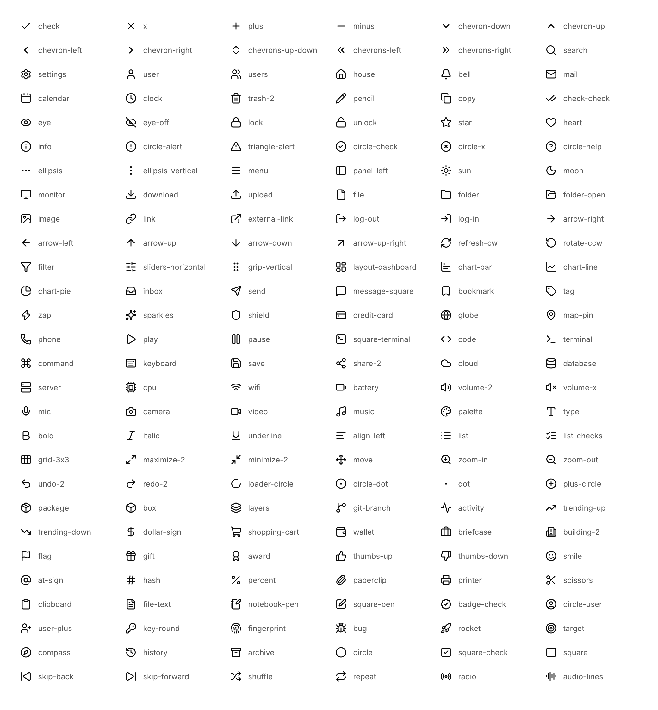

# Icons

CUI embeds 168 icons from [Lucide](https://lucide.dev) (ISC license). Each icon is a UTF-8 string, so it works on its own or inside any label:

```c
cui_icon(ui, CUI_ICON_ZAP, 16, CUI_COLOR_ACCENT);
cui_button(ui, "New", .icon = CUI_ICON_PLUS);
cui_text(ui, CUI_ICON_CHECK " Saved");          /* inline, centered on the text */
```

## Built-in icons



| | | | |
|---|---|---|---|
| `CUI_ICON_CHECK` | `CUI_ICON_X` | `CUI_ICON_PLUS` | `CUI_ICON_MINUS` |
| `CUI_ICON_CHEVRON_DOWN` | `CUI_ICON_CHEVRON_UP` | `CUI_ICON_CHEVRON_LEFT` | `CUI_ICON_CHEVRON_RIGHT` |
| `CUI_ICON_CHEVRONS_UP_DOWN` | `CUI_ICON_CHEVRONS_LEFT` | `CUI_ICON_CHEVRONS_RIGHT` | `CUI_ICON_SEARCH` |
| `CUI_ICON_SETTINGS` | `CUI_ICON_USER` | `CUI_ICON_USERS` | `CUI_ICON_HOUSE` |
| `CUI_ICON_BELL` | `CUI_ICON_MAIL` | `CUI_ICON_CALENDAR` | `CUI_ICON_CLOCK` |
| `CUI_ICON_TRASH_2` | `CUI_ICON_PENCIL` | `CUI_ICON_COPY` | `CUI_ICON_CHECK_CHECK` |
| `CUI_ICON_EYE` | `CUI_ICON_EYE_OFF` | `CUI_ICON_LOCK` | `CUI_ICON_UNLOCK` |
| `CUI_ICON_STAR` | `CUI_ICON_HEART` | `CUI_ICON_INFO` | `CUI_ICON_CIRCLE_ALERT` |
| `CUI_ICON_TRIANGLE_ALERT` | `CUI_ICON_CIRCLE_CHECK` | `CUI_ICON_CIRCLE_X` | `CUI_ICON_CIRCLE_HELP` |
| `CUI_ICON_ELLIPSIS` | `CUI_ICON_ELLIPSIS_VERTICAL` | `CUI_ICON_MENU` | `CUI_ICON_PANEL_LEFT` |
| `CUI_ICON_SUN` | `CUI_ICON_MOON` | `CUI_ICON_MONITOR` | `CUI_ICON_DOWNLOAD` |
| `CUI_ICON_UPLOAD` | `CUI_ICON_FILE` | `CUI_ICON_FOLDER` | `CUI_ICON_FOLDER_OPEN` |
| `CUI_ICON_IMAGE` | `CUI_ICON_LINK` | `CUI_ICON_EXTERNAL_LINK` | `CUI_ICON_LOG_OUT` |
| `CUI_ICON_LOG_IN` | `CUI_ICON_ARROW_RIGHT` | `CUI_ICON_ARROW_LEFT` | `CUI_ICON_ARROW_UP` |
| `CUI_ICON_ARROW_DOWN` | `CUI_ICON_ARROW_UP_RIGHT` | `CUI_ICON_REFRESH_CW` | `CUI_ICON_ROTATE_CCW` |
| `CUI_ICON_FILTER` | `CUI_ICON_SLIDERS_HORIZONTAL` | `CUI_ICON_GRIP_VERTICAL` | `CUI_ICON_LAYOUT_DASHBOARD` |
| `CUI_ICON_CHART_BAR` | `CUI_ICON_CHART_LINE` | `CUI_ICON_CHART_PIE` | `CUI_ICON_INBOX` |
| `CUI_ICON_SEND` | `CUI_ICON_MESSAGE_SQUARE` | `CUI_ICON_BOOKMARK` | `CUI_ICON_TAG` |
| `CUI_ICON_ZAP` | `CUI_ICON_SPARKLES` | `CUI_ICON_SHIELD` | `CUI_ICON_CREDIT_CARD` |
| `CUI_ICON_GLOBE` | `CUI_ICON_MAP_PIN` | `CUI_ICON_PHONE` | `CUI_ICON_PLAY` |
| `CUI_ICON_PAUSE` | `CUI_ICON_SQUARE_TERMINAL` | `CUI_ICON_CODE` | `CUI_ICON_TERMINAL` |
| `CUI_ICON_COMMAND` | `CUI_ICON_KEYBOARD` | `CUI_ICON_SAVE` | `CUI_ICON_SHARE_2` |
| `CUI_ICON_CLOUD` | `CUI_ICON_DATABASE` | `CUI_ICON_SERVER` | `CUI_ICON_CPU` |
| `CUI_ICON_WIFI` | `CUI_ICON_BATTERY` | `CUI_ICON_VOLUME_2` | `CUI_ICON_VOLUME_X` |
| `CUI_ICON_MIC` | `CUI_ICON_CAMERA` | `CUI_ICON_VIDEO` | `CUI_ICON_MUSIC` |
| `CUI_ICON_PALETTE` | `CUI_ICON_TYPE` | `CUI_ICON_BOLD` | `CUI_ICON_ITALIC` |
| `CUI_ICON_UNDERLINE` | `CUI_ICON_ALIGN_LEFT` | `CUI_ICON_LIST` | `CUI_ICON_LIST_CHECKS` |
| `CUI_ICON_GRID_3X3` | `CUI_ICON_MAXIMIZE_2` | `CUI_ICON_MINIMIZE_2` | `CUI_ICON_MOVE` |
| `CUI_ICON_ZOOM_IN` | `CUI_ICON_ZOOM_OUT` | `CUI_ICON_UNDO_2` | `CUI_ICON_REDO_2` |
| `CUI_ICON_LOADER_CIRCLE` | `CUI_ICON_CIRCLE_DOT` | `CUI_ICON_DOT` | `CUI_ICON_PLUS_CIRCLE` |
| `CUI_ICON_PACKAGE` | `CUI_ICON_BOX` | `CUI_ICON_LAYERS` | `CUI_ICON_GIT_BRANCH` |
| `CUI_ICON_ACTIVITY` | `CUI_ICON_TRENDING_UP` | `CUI_ICON_TRENDING_DOWN` | `CUI_ICON_DOLLAR_SIGN` |
| `CUI_ICON_SHOPPING_CART` | `CUI_ICON_WALLET` | `CUI_ICON_BRIEFCASE` | `CUI_ICON_BUILDING_2` |
| `CUI_ICON_FLAG` | `CUI_ICON_GIFT` | `CUI_ICON_AWARD` | `CUI_ICON_THUMBS_UP` |
| `CUI_ICON_THUMBS_DOWN` | `CUI_ICON_SMILE` | `CUI_ICON_AT_SIGN` | `CUI_ICON_HASH` |
| `CUI_ICON_PERCENT` | `CUI_ICON_PAPERCLIP` | `CUI_ICON_PRINTER` | `CUI_ICON_SCISSORS` |
| `CUI_ICON_CLIPBOARD` | `CUI_ICON_FILE_TEXT` | `CUI_ICON_NOTEBOOK_PEN` | `CUI_ICON_SQUARE_PEN` |
| `CUI_ICON_BADGE_CHECK` | `CUI_ICON_CIRCLE_USER` | `CUI_ICON_USER_PLUS` | `CUI_ICON_KEY_ROUND` |
| `CUI_ICON_FINGERPRINT` | `CUI_ICON_BUG` | `CUI_ICON_ROCKET` | `CUI_ICON_TARGET` |
| `CUI_ICON_COMPASS` | `CUI_ICON_HISTORY` | `CUI_ICON_ARCHIVE` | `CUI_ICON_CIRCLE` |
| `CUI_ICON_SQUARE_CHECK` | `CUI_ICON_SQUARE` | `CUI_ICON_SKIP_BACK` | `CUI_ICON_SKIP_FORWARD` |
| `CUI_ICON_SHUFFLE` | `CUI_ICON_REPEAT` | `CUI_ICON_RADIO` | `CUI_ICON_AUDIO_LINES` |

## Using any Lucide icon

The embedded font is a subset. Load the full Lucide font (the `lucide.ttf` from the `lucide-static` package) as the icon role and use any codepoint from its `codepoints.json`:

```c
cui_font all = cui_font_load_file(ui, "lucide.ttf");
cui_font_set_role(ui, CUI_FONT_ICONS, all);
cui_icon(ui, "\xee\x80\x83", 16, CUI_COLOR_FOREGROUND);   /* U+E003 as UTF-8 */
```

To change the embedded set, edit the list in `tools/build_fonts.py` and run:

```sh
python3 tools/build_fonts.py --lucide path/to/lucide.ttf --codepoints path/to/codepoints.json
```

## Other icon fonts

Any icon font works the same way: load it, make it the icon role (or a fallback of the body font), and use its codepoints as UTF-8 strings.
