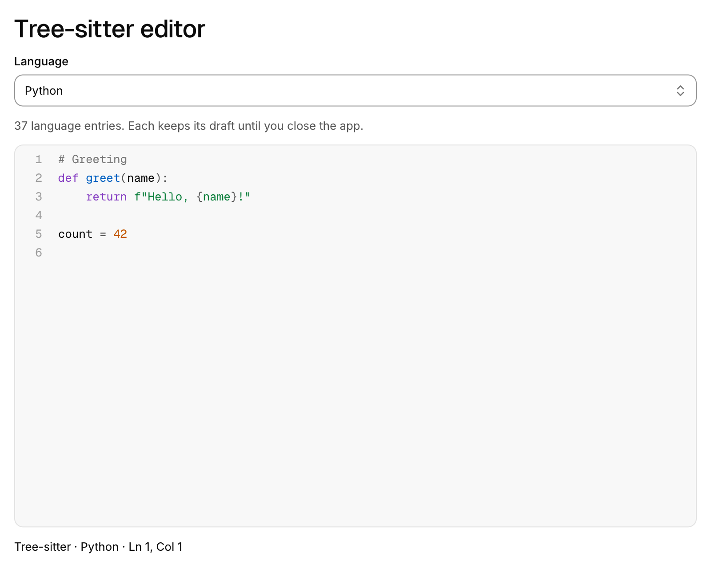

# Tree-sitter language demo

An optional native editor with **GPUI Kit’s full Tree-sitter language set**: 37
language entries backed by 36 parsers from 34 pinned grammar crates. The set
matches [GPUI Kit 0.7.1 at `dc00da1`](https://github.com/longbridge/gpui-kit/blob/dc00da1837f16a6da42280535d76a2d7acc4a40e/crates/component/Cargo.toml).
Exact resolved crate versions and registry checksums are recorded in
[`languages.json`](languages.json); the published crates supply generated C,
so the demo needs no Rust compiler. The core’s built-in lexer supports the same
[37 language entries](../../docs/components-more.md#syntax-highlighting-languages).
The searchable Language picker changes the parser and sample; each draft stays
in memory until the app closes. Use Tab and the arrow keys to operate the picker.

<picture><source media="(prefers-color-scheme: dark)" srcset="../../docs/images/components/tree-sitter-languages-dark.png"></picture>

After installing a Tree-sitter runtime as described in [integration](../../docs/integration.md#optional-tree-sitter-highlighting):

```sh
cmake -S . -B build-tree-sitter -DCMAKE_BUILD_TYPE=Debug \
  -DCUI_TREE_SITTER=ON -DCUI_TREE_SITTER_DEMO=ON \
  -DCMAKE_PREFIX_PATH=/path/to/tree-sitter/install
cmake --build build-tree-sitter --target tree_sitter --parallel 4
./build-tree-sitter/examples/tree_sitter
./build-tree-sitter/examples/tree_sitter --check
```

The demo requires CMake 3.18+, Python 3, a Tree-sitter runtime supporting
grammar ABI 15 (tested with 0.27.2), and a C11 compiler for upstream grammars.
CUI itself remains C99. The first configure downloads grammar archives pinned
by crate version and the Cargo registry SHA-256 in `languages.json`. Later
builds use CMake's `_deps/` cache. No Node, Rust or Tree-sitter CLI is needed. The demo can be built
with tests disabled; with tests enabled, CTest also runs its `--check` mode.
The resolved Swift 0.7.4 scanner already includes the allocation fix.
The core and `cui::tree_sitter` add-on contain no grammar bundle, and the demo
option is off by default.

`generate.py` creates portable baseline highlight queries from each grammar's
node metadata: keywords, comments, strings, numbers, common types and names.
These are intentionally smaller than upstream editor query suites. There is no
local-variable analysis or embedded-language injection. Markdown block and
inline parsers are separate entries; fenced code is not parsed as an embedded
language. EJS and ERB share one compiled parser.
Matching GPUI Kit’s parser set does not reproduce its full query/injection
pipeline. Individual grammar versions determine dialect coverage. Use your
own queries/grammars with the add-on for more detailed highlighting.

`--check` creates every document, compiles every generated query, parses its
sample without syntax errors, checks highlight output and exercises cached and
edited updates. Generated `.scm` files are in
`build-tree-sitter/examples/tree_sitter_grammars/generated/` for inspection.
That directory also contains a copy of [`THIRD_PARTY_NOTICES.txt`](THIRD_PARTY_NOTICES.txt),
which preserves upstream grammar licenses, including notices omitted from some
published crate archives. Preserve these notices when redistributing the demo.
